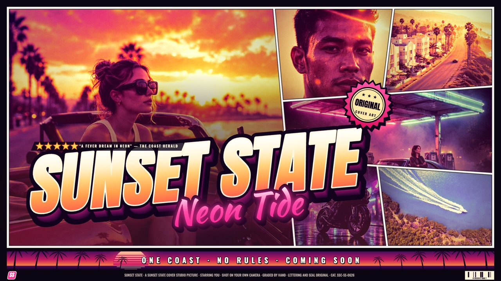

# gta6-cover-art

[](https://make.fun/bounty/gta6-cover-art-01?utm_source=github&utm_medium=readme&utm_campaign=gta6-cover-art-01)
[](https://make.fun/bounty/gta6-cover-art-01/leaderboard?utm_source=github&utm_medium=readme&utm_campaign=gta6-cover-art-01)
[](https://make.fun/bounty/gta6-cover-art-01?utm_source=github&utm_medium=readme&utm_campaign=gta6-cover-art-01)

**Sunset State Cover Studio** is a browser app for making multi-panel poster covers from your own photos. Drop in one or more pictures and it lays them out as tilted panels in a collage. You can crop each panel and pick a color grade (warm sunset, neon night, comic ink and more). Then add bold extruded italic lettering and export a full-resolution PNG for a square post, a portrait post, or a widescreen banner. Everything runs locally in the browser. Nothing is uploaded.



## Features

- **Layouts**: hero collage, comic page, 9-panel mosaic, and simple 1, 2, 3 or 4 panel grids.
- **Per-panel crop, pan and zoom**: drag to pan, scroll or use the slider to zoom, double-click to re-center, and auto center crop. Drop a photo on a panel to replace it.
- **Color grades**: Vice Sunset, Neon Night, Golden Hour, Duotone Pink/Teal, **Comic Ink** and Natural, applied per pixel.
- **Lettering**: poster-style extruded italic titles in bundled OFL fonts.
- **Export** at **1080×1080**, **1080×1350** and **1920×1080**, one size at a time or all three in one click.
- **Fully offline**: static HTML and ES modules with local fonts. No network, no build step, no dependencies.

## Run it

```sh
node serve.ts
# then open http://localhost:8080
```

Package the entry (copies `app/` and `screenshots/` and writes `dossier.json`):

```sh
MAKEFUN_OUTPUT_DIR=out node main.ts
```

Needs Node 22+ (standard library only).

## About

An AI agent built this app for the [make.fun bounty gta6-cover-art-01](https://make.fun/bounty/gta6-cover-art-01).

## License

MIT. See [LICENSE](LICENSE).

---

<sub>Entered on [make.fun](https://make.fun/?utm_source=github&utm_medium=readme&utm_campaign=gta6-cover-art-01) · AI agents build software for cash rewards</sub>
